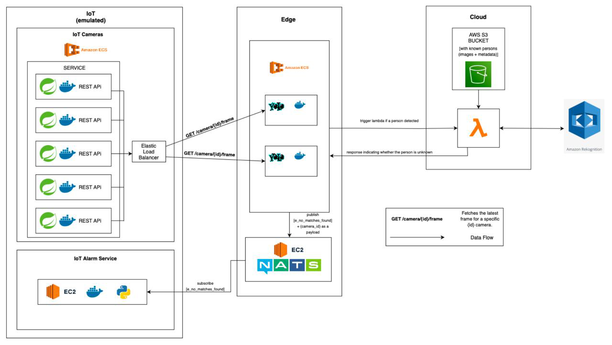

# DS-Project

Partial implementation of a **Geo-Distributed Surveillance System**, which was further developed and implemented as part of the _Distributed Systems Course (University of Innsbruck, WS2024)_ on the local university GitLab instance.

This repository currently includes the **emulated IoT layer** of the full project scope.

---

## 🧰 Implemented Features (IoT Layer)

✔ **IoT Camera Emulation**

- Multiple cameras simulated as REST API services (Spring Boot + Docker).
- Frames extracted from video files (OpenCV integration).
- Video files loaded from S3 (with local caching support).

✔ **Load Balancing**

- Elastic Load Balancer distributes requests across emulated cameras.

✔ **Infrastructure Setup**

- Terraform used for AWS ECS/EC2 provisioning.
- Dockerized services for reproducibility.

---

## 🌐 IoT Layer (Emulated)

The current repository implements the **IoT layer** of the distributed surveillance system.

### Components

- **IoT Cameras**: Implemented using Amazon ECS containers, each running a Spring Boot REST API service.
- **Load Balancer**: Elastic Load Balancer distributes requests across multiple camera services.
- **Frame Access**: Cameras continuously capture frames, accessible via REST API endpoints:
  ```
  GET /camera/{id}/frame
  ```
- **Infrastructure**:
  - **Spring Boot** for the REST API
  - **OpenCV** to extract frames from videos at specific timestamps
  - **DynamoDB** to synchronize the last requested frame timestamp across ECS instances
  - **S3 Bucket** for video storage, cached locally on startup
  - **Terraform** for automated infrastructure deployment

---

## 📊 Dataset

This project uses the **[WiseNET Multi-camera Surveillance Dataset](https://data.4tu.nl/articles/dataset/WiseNET_Multi-camera_dataset/12714416/1)**, a comprehensive collection of surveillance footage for security applications.

### Dataset Characteristics

- **Source**: WiseNET surveillance footage database
- **Format**: Compressed video files (`.mp4`)
- **Resolution**: 1280×720 pixels
- **Frame Rate**: 30 fps
- **Content**: Indoor surveillance scenarios with multiple subjects, varying lighting conditions, and occlusions

### Why WiseNET?

This dataset provides realistic surveillance scenarios that test the system’s ability to:

- Detect multiple persons in different poses and positions
- Handle challenging lighting and camera angles
- Process partially occluded individuals
- Maintain accuracy during subject movement and scene transitions

---

## 🏗️ System Architecture (Current Scope)

The current repo focuses on the **IoT (emulated) layer**:



- Each IoT camera is deployed as a **Spring Boot REST API** inside a container.
- An **Elastic Load Balancer** routes frame requests across camera instances.
- Edge services fetch frames via:
  ```
  GET /camera/{id}/frame
  ```

---

## 👥 Authors

- Danylo Moskaliuk
